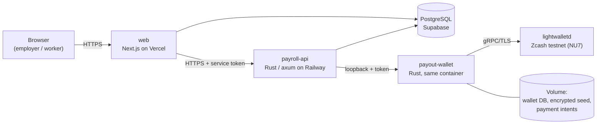

# hushush

**Private payroll in Zcash.** Companies pay people in shielded ZEC, either
streamed by the second or vested over time. Amounts, recipients and memos stay
private on chain.

> **Status: running on the Zcash testnet.** It uses test coins (TAZ), which
> have no monetary value. The network is fixed at compile time, so there is no
> mainnet code path. See [Status and limitations](#status-and-limitations).

**Live demo:** <https://hushush.vercel.app> (web app on Vercel, backend on
Railway, database on Supabase).

---

## Contents

- [Why hushush](#why-hushush)
- [What it does](#what-it-does)
- [How a payment works](#how-a-payment-works)
- [Privacy model](#privacy-model)
- [Safety: paying exactly once](#safety-paying-exactly-once)
- [Architecture](#architecture)
- [Repository layout](#repository-layout)
- [Try it on the live demo](#try-it-on-the-live-demo)
- [Run it locally](#run-it-locally)
- [Tests and verification](#tests-and-verification)
- [Deployment](#deployment)
- [Status and limitations](#status-and-limitations)
- [Roadmap](#roadmap)
- [Documentation](#documentation)

---

## Why hushush

On a transparent blockchain, **paying someone exposes them**. Anyone can see
who was paid, how much and how often, so salaries, team size and payroll
timing become public. Most crypto payroll tools inherit this.

Zcash's shielded pools hide the sender, the recipient, the amount and the
memo. hushush builds a payroll product on top of them:
- **employers** get a clear dashboard and a simple way to pay;
- **workers** get their pay, privately, to a shielded address that only they
  control and only they can see;
- **nothing about who earns what** is visible on chain.

## What it does

### For employers
- **Streams (ongoing pay).**
  - Set a total, a start and an end. The worker earns it evenly, **every
    second**, and withdraws at each **20% milestone** and again at the end.
  - You can end a stream early. What was earned stays withdrawable.
- **Vesting (allocations over time).**
  - Grant a fixed ZEC amount that vests **linearly** to one person, with an
    optional **cliff**.
  - Agreements must be activated before their start date.
  - Cancelling stops further vesting. What has already vested stays owed and
    withdrawable.
- **Worker links.** Each stream produces a one-time link (and QR code) to send
  to the worker. Whoever joins through it first gets the stream.
- **Payout wallet.** Each company pays from **its own account** in the payout
  wallet. On testnet, a **Get test TAZ** button tops it up.
- **Dashboard.** Overview figures and charts, plus separate pages for Streams,
  Vesting, Payments and the Payout wallet.

### For workers
- **Join with the link** and sign up with a **passkey** (Face ID, fingerprint,
  Windows Hello). There's no password, and an email sign-in link is an
  optional backup.
- **Lock a shielded payout address** once per stream or agreement. The
  employer **never sees it**.
- **Watch earnings tick live,** withdraw when they unlock, and see each payout
  go from *Sending* to *Confirming n/10* to **Paid ✓**.

### One account for both
The same account can pay people and get paid. You choose one view at
sign-up, and you can switch at any time.

## How a payment works

1. **Request.** The worker taps **Withdraw**.
   - payroll-api checks that the amount is available.
   - In one database transaction, it **reserves** the amount and creates a
     **payout** record.
   - Repeated taps return the same payout.
2. **Build and send.** payroll-api asks the **payout wallet** to pay it.
   - The wallet first writes a durable **intent** for the payout.
   - It then builds a **shielded** transaction from the company's account to
     the worker's locked address, with an encrypted memo
     `hushush payout <payout id>`.
   - It stores the signed bytes, then broadcasts them.
3. **Confirm.** A background worker tracks the transaction until it has
   **10 confirmations**.
   - Before settling, it checks the transaction *as served by the chain*:
     recipient, amount, fee and pool.
   - Only then is the payout marked **confirmed** and the claim **settled**.
     Nothing counts as paid before that.
4. **Failure.** A payout is released back to the worker only when the system
   can **prove** nothing was or will be mined. Anything ambiguous waits for
   reconciliation instead of risking a second payment.

## Privacy model

| Visible on chain to anyone | Hidden |
|---|---|
| That a transaction happened, and when (block, timing) | Sender and recipient addresses |
| Its fee, and its size in shielded actions | Amount |
| | Memo (encrypted to the recipient) |
| | Which notes were spent |

All payouts are **fully shielded**:
* There are no transparent inputs or outputs.
* Value stays within one shielded pool, so no amount leaks from moving between
  pools.
* Recipients must be Unified Addresses with an Orchard-family receiver.
  Transparent and Sapling-only addresses are refused.

**Off chain:**
* **Workers' addresses are sealed at rest** with XChaCha20-Poly1305, bound to
  their stream or agreement, and shown only to the worker.
* **Database tables use row-level security,** so platform API roles see
  nothing.
* **Logs never contain** addresses, keys or seeds.

Independent checks are in [docs/PHASE4_REPORT.md](docs/PHASE4_REPORT.md) §3:
14 live transactions were verified against ZecBlock, a separately operated
node and indexer, and no plaintext amount, memo, payout id or address appears
in the public bytes.

## Safety: paying exactly once

Money movement is designed to be **exactly-once**, even through crashes,
retries, double taps and lost network responses:

- **One payout per claim.** Database constraints make a claim's payout unique,
  and an idempotency key returns the original request on repeats.
- **Durable intents.** The wallet records each payment *before* building it,
  and stores the signed bytes *before* broadcasting them. After a crash it
  re-sends the **same** transaction (same txid) and never builds a
  replacement.
- **Fencing.** An interrupted request is fenced at the wallet, so a late
  duplicate can't pay.
- **Chain-aware recovery.** Before re-sending, the wallet looks the transaction
  up by txid. If it's already mined or in the mempool, it's recorded without
  re-sending (the OBS-1 fix).
- **Settlement only from the chain.** A claim is settled only by a payout
  confirmed at depth and verified from chain-served bytes.

This was tested by **killing processes at every step** of a real testnet
payment:
* before building;
* after signing;
* after storing the signed transaction;
* right after the network accepted it;

and also with a **lost intent store**, **two concurrent server instances**,
and cancellation in the middle of a payout. Every case recovered with exactly
one payment. See [docs/PHASE4_REPORT.md](docs/PHASE4_REPORT.md) and
[docs/VESTING_PHASE4_FAULT_INJECTION.md](docs/VESTING_PHASE4_FAULT_INJECTION.md).

## Architecture



| Component | Role | Trust |
|---|---|---|
| **web** (Next.js 16, React 19, Tailwind 4) | UI, passkey and email sign-in, sessions; calls payroll-api server-side | Holds no keys; never sees the wallet token |
| **payroll-api** (Rust, axum) | The payroll engine over HTTP: streams, vesting, claims, payouts, background reconciler; seals payout addresses | Holds the address-sealing key; talks to the wallet only on loopback |
| **payroll** (Rust library) | Accrual and vesting arithmetic, the claim and payout state machines, migrations; PostgreSQL and SQLite backends | Pure logic + storage |
| **payout-wallet** (Rust) | The **only** process with spend authority: quotes, builds, signs, broadcasts, tracks; per-company accounts (ZIP 32) | Never exposed publicly; testnet only |
| **wallet-proof** (Rust) | Wallet library and CLI on the official **librustzcash** stack (`zcash_client_backend`, `zcash_client_sqlite`) | Shared with payout-wallet; no custom cryptography |

**Network note:** the Zcash testnet is on **NU7**, so the wallet uses the
NU7-capable librustzcash pre-releases, pinned exactly (see
[docs/PHASE0_REPORT.md](docs/PHASE0_REPORT.md)). It talks to
`testnet.zec.rocks`, and on every sync checks that the server is on testnet
and on the expected consensus branch.

## Repository layout

```
hushush/
├── web/             Next.js app (UI, auth, route handlers); migrations/ for its tables
├── payroll/         Payroll engine library + SQL migrations (SQLite and PostgreSQL)
├── payroll-api/     HTTP service around the engine; drives payouts
├── payout-wallet/   Payout wallet service (spend authority); scripts/ for live testnet runs
├── wallet-proof/    librustzcash wallet library + CLI (create, sync, send, observe)
├── deploy/          Dockerfile + start script for the backend; helpers for Railway/Vercel variables
├── docs/            Design and validation reports, with evidence
└── railway.json     Railway build/deploy settings
```

## Try it on the live demo

1. Open <https://hushush.vercel.app> and **sign up as an employer** with a
   passkey. Name your company.
2. **Payout wallet → Get test TAZ.** This funds your company's account from
   the testnet treasury. It becomes spendable after a few minutes.
3. **Streams → New stream:** e.g. 0.002 ZEC ending in 10 minutes. Copy the
   **worker link**.
4. In **another browser** (or a private window), open the link and **sign up
   as the worker**.
5. **Lock a shielded testnet payout address.** It must be a Unified Address
   starting with `utest1` and including an Orchard receiver.
   * The store versions of mobile wallets such as Zashi have no testnet mode.
   * The simplest receiver is a CLI wallet from `wallet-proof`:
     `hushush-wallet-proof init <name>`, then `address <name>`.
6. **Withdraw** at the 20% milestone. The payout shows *Confirming n/10*, then
   **Paid ✓** (about 12–15 minutes). Check it on a testnet explorer, e.g.
   `https://testnet.zecblock.com/tx/<txid>`.

**Vesting:**
- The recipient must already be a member of your company: someone who joined
  one of your streams.
- Create an agreement starting a few minutes ahead and activate it before the
  start.
- The minimum duration is one day.

## Run it locally

**Prerequisites:**
- **Rust 1.89+**;
- **Node.js 20.9+** (Next.js 16);
- **PostgreSQL** (tested with 17);
- on Windows, Git Bash and Visual Studio Build Tools (C++).

The first Rust build takes 20–30 minutes because of the zero-knowledge
crates. On machines with little RAM, build with `-j2`.

```bash
# 1. A testnet wallet for payouts (stored outside the repo; the CLI refuses git trees)
cd wallet-proof && cargo build
./target/debug/hushush-wallet-proof init treasury      # prints its shielded address
#    Fund it with testnet TAZ, then: ./target/debug/hushush-wallet-proof sync treasury

# 2. The payout wallet service (127.0.0.1:7979)
cd ../payout-wallet && cargo build
WALLET_API_TOKEN=<32+ random chars> WALLET_NAME=treasury \
WALLET_LIGHTWALLETD_URL=https://testnet.zec.rocks:443 \
./target/debug/hushush-payout-wallet

# 3. payroll-api (127.0.0.1:7878); migrates the database on start
cd ../payroll-api && cargo build
PAYROLL_DATABASE_URL=postgres://… PAYROLL_API_TOKEN=<random> \
WALLET_URL=http://127.0.0.1:7979 WALLET_API_TOKEN=<same as above> \
PAYOUT_ENABLED_ORGS='*' PAYOUT_ADDRESS_KEY=$(openssl rand -hex 32) \
PAYOUT_CONFIRMATIONS=3 ./target/debug/hushush-payroll-api

# 4. The web app (http://localhost:3000)
cd ../web && npm ci
cp .env.example .env.local      # DATABASE_URL, PAYROLL_API_URL=http://127.0.0.1:7878, PAYROLL_API_TOKEN, APP_URL
npm run db:migrate
npm run dev
```

Every variable is documented in
[docs/PHASE3_PAYOUTS.md](docs/PHASE3_PAYOUTS.md) §6 and
[docs/DEPLOY_RAILWAY.md](docs/DEPLOY_RAILWAY.md).

## Tests and verification

| Suite | Command | Result |
|---|---|---|
| Payroll engine (SQLite **and** PostgreSQL) | `cd payroll && PAYROLL_TEST_DATABASE_URL=postgres://… cargo test -- --include-ignored` | 198 passed |
| payroll-api | `cd payroll-api && cargo test` | 5 passed |
| payout-wallet | `cd payout-wallet && cargo test` | 19 passed |
| wallet-proof (offline: mocked chain, real proofs) | `cd wallet-proof && cargo test -j1` | 24 passed (+3 live tests, `--ignored`) |
| Web (real route handlers + real payroll-api + PostgreSQL) | `cd web && TEST_DATABASE_URL=postgres://… npm test` | 84 passed |
| Web static checks | `npm run typecheck && npm run lint && npm run build` | clean |

**Live testnet evidence.** Each of these is a real shielded transaction,
confirmed on chain and checked independently:

| Validation | Transaction | Report |
|---|---|---|
| First shielded payment (Phase 0) | `e466d871…` | [PHASE0_REPORT.md](docs/PHASE0_REPORT.md) |
| Crash, concurrency and loss scenarios for stream payouts (14 transactions) | see report | [PHASE4_REPORT.md](docs/PHASE4_REPORT.md) |
| Vesting withdrawal | `8571ed19…` | [VESTING_PHASE3_TESTNET_VALIDATION.md](docs/VESTING_PHASE3_TESTNET_VALIDATION.md) |
| Vesting fault injection (crash before build, after signing, after build, after broadcast, cancel in flight) | 5 transactions | [VESTING_PHASE4_FAULT_INJECTION.md](docs/VESTING_PHASE4_FAULT_INJECTION.md) |
| Chain-aware recovery fix (OBS-1) | `100b164f…` | [OBS1_SCENARIO_C_VALIDATION.md](docs/OBS1_SCENARIO_C_VALIDATION.md) |
| First withdrawal from the **deployed** app | [`4ea5a95f…`](https://testnet.zecblock.com/tx/4ea5a95fa307d4ac1a27501280ce47a936311a91d64a68f81aa303345c56efc2) | (live demo) |

## Deployment

**Backend (Railway):** one service runs payroll-api (public, HTTPS) and the
payout wallet (private, same container).
* It's built from [`deploy/api.Dockerfile`](deploy/api.Dockerfile).
* A persistent volume holds the wallet database and the payment intents.
* The wallet's encrypted seed and its decryption identity arrive as two
  separate secrets; the plaintext seed is never written to disk.

**Web app:** Vercel, with root directory `web`, in the same region as the
database.

**Database:** Supabase PostgreSQL, using the session pooler, with
CA-verified TLS and row-level security.

The step-by-step guide is in [docs/DEPLOY_RAILWAY.md](docs/DEPLOY_RAILWAY.md).

## Status and limitations

**Testnet only.** This version is a working, tested product on the Zcash
testnet. It isn't ready for real money, and these are the reasons:
- **Custody.** The payout wallet's spending key runs on a server. That's fine
  for test coins, but not for real funds.
- **Shared infrastructure.** It uses a public lightwalletd server rather than
  its own Zcash node, and a shared testnet treasury funds the companies'
  "Get test TAZ" top-ups.
- **No four-eyes approval.** A single manager can create and activate a
  vesting agreement, and payouts aren't approved by a second person.
- **Product gaps:**
  * vesting recipients must first join through a stream link (there's no
    vesting-only invite yet);
  * the Payments page lists stream withdrawals only (vesting withdrawals are
    on each agreement's page);
  * there are no email notifications.
- **Passkeys are tied to the site's domain.** Moving to a new domain needs the
  email sign-in fallback.

## Roadmap

**v2: non-custodial on mainnet.** Employers keep funds in **their own wallet**
(e.g. Zashi or Keystone) with their own seed.
- hushush holds only a **view-only key**.
- It prepares each shielded payout (as a PCZT, a partially created Zcash
  transaction).
- The employer **approves and signs it on their own device**.

hushush could then see payroll but never move funds. See
[docs/V2_NONCUSTODIAL_ROADMAP.md](docs/V2_NONCUSTODIAL_ROADMAP.md) and
[docs/MAINNET_OPTION_B_SELF_CUSTODY.md](docs/MAINNET_OPTION_B_SELF_CUSTODY.md).

## Documentation

Each phase was built, tested and reported separately:

| Report | Covers |
|---|---|
| [PHASE0_REPORT.md](docs/PHASE0_REPORT.md) | Feasibility: shielded testnet payments on librustzcash, NU7 pinning |
| [PHASE1_PAYROLL.md](docs/PHASE1_PAYROLL.md) | Payroll engine: accrual, streams, claims, both database backends |
| [PHASE2_WEB.md](docs/PHASE2_WEB.md) | Web app and payroll-api |
| [PHASE3_PAYOUTS.md](docs/PHASE3_PAYOUTS.md) | Payout wallet, payout state machine, configuration and secrets |
| [PHASE4_REPORT.md](docs/PHASE4_REPORT.md) | Security review, exactly-once proofs, independent privacy verification |
| [PHASE5_REPORT.md](docs/PHASE5_REPORT.md) | Passkeys, worker links, locked addresses, milestone withdrawals |
| [PHASE6_COMPANY_WALLETS.md](docs/PHASE6_COMPANY_WALLETS.md) | Per-company payout accounts and the testnet faucet |
| [VESTING_PHASE1_ACCOUNTING.md](docs/VESTING_PHASE1_ACCOUNTING.md) – [VESTING_PHASE4_FAULT_INJECTION.md](docs/VESTING_PHASE4_FAULT_INJECTION.md) | Vesting: accounting, payouts and UI, live validation, fault injection |
| [OBS1_WALLET_RECOVERY_FIX.md](docs/OBS1_WALLET_RECOVERY_FIX.md), [OBS1_SCENARIO_C_VALIDATION.md](docs/OBS1_SCENARIO_C_VALIDATION.md) | Chain-aware rebroadcast fix and its live validation |
| [DEPLOY_RAILWAY.md](docs/DEPLOY_RAILWAY.md) | Production deployment |

## License

No license has been chosen yet. Until one is added, all rights are reserved
by the authors.
