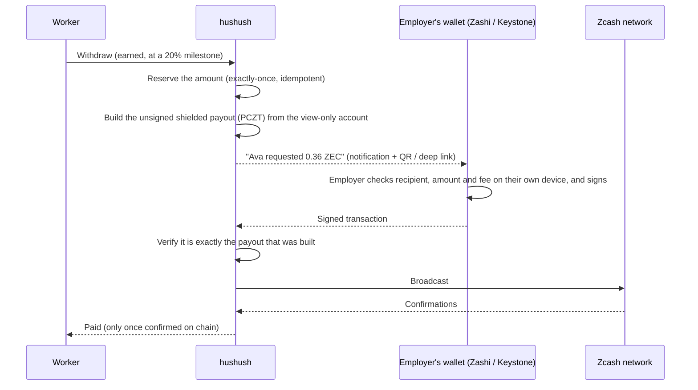

# hushush v2: non-custodial payroll on Zcash mainnet

> **Status: planned, not yet built.** v1 runs on Zcash **testnet** today. This
> document is our plan for the mainnet version: payroll where **hushush never
> holds anyone's money**.

## In one paragraph

hushush v1 proves the product on testnet: salaries stream by the second, workers
withdraw as they earn, and every payout is a **shielded** Zcash transaction, so
no outsider can see who was paid or how much. To make testing easy, v1 holds the
payout keys itself (each company has its own payout account inside the hushush
payout wallet). **v2 removes that.** On mainnet, the employer keeps their funds
in their **own wallet, with their own seed phrase**. hushush gets a view-only key
to show balances, prepares each payout, and the employer approves it on their
own device. hushush can see payroll, but it can never move funds.

## Why v1 is custodial, and why that's a stage, not the plan

| | v1 (testnet, built) | v2 (mainnet, planned) |
|---|---|---|
| Who holds the funds | hushush, in a per-company payout account | **The employer, in their own wallet** |
| Employer's seed phrase | None | **Their own** (Zashi, or Keystone hardware wallet) |
| Can the employer move funds any time? | No (only worker payouts leave) | **Yes, it's their wallet** |
| If hushush is breached | Company payout accounts are exposed | **Nothing to steal**: hushush holds no spending keys |
| What hushush can do | See and spend | **See only** (viewing key) |
| Payout approval | Automatic | **Employer approves each payout, or a daily batch** |

A custodial testnet made sense: the hard parts could be built and verified
quickly with no real value at risk. Those hard parts are exact accrual,
milestone rules, exactly-once payouts, shielded transactions and chain
verification. All of that carries over to v2 unchanged. What changes is **who
signs**.

## The Zcash constraint, and how we answer it

Streaming platforms on smart-contract chains (Sablier, Superfluid, LlamaPay)
are non-custodial because **a contract holds the money in escrow**. Zcash has
no smart contracts. That is part of what makes it private, but it means there
is no escrow contract to stream from, and no "connect wallet and let the site
spend" either.

So v2 uses what Zcash *does* have:

- **Viewing keys (UFVK).** The employer shares a key that lets hushush **see**
  their payroll wallet's balance and build transactions from it, but **not
  spend**.
- **PCZT (Partially Created Zcash Transactions).** hushush prepares a payout
  transaction, and the employer's wallet adds the proofs and signature. Zashi
  supports signing PCZTs, including with the Keystone hardware wallet. The
  librustzcash libraries hushush already builds on support PCZT.

The streaming itself (accrual, milestones and balances) stays off-chain in
hushush, exactly as in v1. Only the moment money moves needs the employer's
signature.

## How v2 works

### Employer setup (once)

1. Create (or reuse) a **payroll account** in Zashi (or Keystone) and fund it.
   The seed phrase stays with the employer.
2. In hushush, **connect** it by pasting or scanning its **viewing key**.
3. hushush imports it as a **view-only account**. The dashboard shows the real
   balance and whether it covers what each stream owes.

### Each withdrawal

- **The worker sees honest states:** "Waiting for Kestrel Collective to
  approve", then "On the network n/10", then "Paid".
- **If the employer rejects** the payout, or doesn't approve it before it
  expires, the amount goes back to "available". Nothing is ever paid twice or
  lost.

### Keeping approvals light

- **Batch approval:** approve every pending withdrawal in **one transaction,
  one signature and one fee**, for example each morning.
- **An approval schedule shown to workers** ("Kestrel approves payroll daily
  at 9:00 UTC"), so expectations are clear.
- **Reminders and a clear queue** on the employer dashboard.
- **Hardware signing:** with Keystone, approving is a QR scan on an air-gapped
  device.

### What stays exactly the same

- **Shielded payouts:** amount, sender and recipient are hidden on chain.
- **Per-second accrual** in whole zatoshis, 20% milestones and the remainder
  after the end.
- **Exactly-once payouts:** one reservation, one payout, one transaction per
  payout id, verified on chain before "paid".
- **Passkey and email sign-in,** worker links and locked payout addresses.

## Trust and security in v2

| Risk | v2 answer |
|---|---|
| hushush servers breached | Attackers find **viewing keys only**: they can see payroll, they can't move funds |
| hushush goes offline or disappears | Employers still hold their wallets and seed phrases, so no funds are stuck |
| Tampered payout | The employer's own device shows the recipient and amount before signing. hushush also verifies the signed transaction matches what was built before broadcasting |
| Employer spends payroll funds elsewhere | The dashboard shows coverage ("covered vs owed") per stream. A payout built on coins that were since spent is rebuilt, never double-paid |
| Privacy toward hushush | hushush sees the payroll account (it needs to, to run payroll), but the employer can use a **dedicated payroll account** so the rest of their finances stay private |

Because hushush never controls funds in v2, we expect a much lighter
regulatory footprint than a custodial payroll provider. We will confirm this
with legal counsel for each launch market before going live.

## The trade-off we're choosing deliberately

v1's "withdraw and get paid within minutes, any time" becomes **"request any
time, paid when the employer approves"**: within minutes for an employer who
approves promptly, or same-day with daily batching. We think that's the right
trade on mainnet: **employers keep full control of their money**, and nobody,
including hushush, holds a pot of everyone's payroll.

Later, as an **opt-in**, we may offer a "managed" mode for employers who want
instant automatic payouts. That would be hushush-held keys built to mainnet
standards: hardware security modules, per-company spending limits,
monitoring, insurance and the required licences. **Non-custodial is the
default.**

## v2 build plan

| Step | What | Builds on (already in v1) |
|---|---|---|
| 1 | **Connect a payroll wallet:** import a viewing key as a view-only account, plus coverage checks | Multi-account payout wallet (v1 Phase 6), chain sync, balances |
| 2 | **Prepare payouts as PCZTs** instead of signing them | librustzcash proposal → transaction pipeline, payout policy checks |
| 3 | **Approval states** in the payout engine: `awaiting_approval`, `rejected`, `expired`, with release of the reserved amount | Exactly-once payout state machine and reconciler (v1 Phases 3–5) |
| 4 | **Signed-transaction intake:** verify, then broadcast | On-chain payout verification (recipient, amount and memo checks, v1 Phase 3) |
| 5 | **Employer UX:** connect-wallet onboarding, approvals queue, QR codes and deep links, batch approval, notifications | Employer dashboard (v1) |
| 6 | **Worker UX:** "waiting for approval" state and the employer's approval schedule | Worker dashboard and stream cards (v1) |
| 7 | **Testnet pilot** with Zashi and Keystone, then a mainnet launch after a security review and legal review | v1 live testnet test harness |

## What judges can verify today (v1, testnet)

- **Real shielded payouts** on the Zcash NU7 testnet, exactly-once under
  concurrent taps, confirmed and verified on chain. See the live run logs in
  `payout-wallet/evidence/` and [PHASE6_COMPANY_WALLETS.md](PHASE6_COMPANY_WALLETS.md).
- **Per-company payout accounts:** each company's withdrawals are paid only
  from its own account. This is the foundation step 1 builds on.
- **Security review and privacy checks:** [PHASE4_REPORT.md](PHASE4_REPORT.md).
- **Deeper technical design** of the v2 approval flow (states, PCZT handling,
  trade-offs): [MAINNET_OPTION_B_SELF_CUSTODY.md](MAINNET_OPTION_B_SELF_CUSTODY.md).
